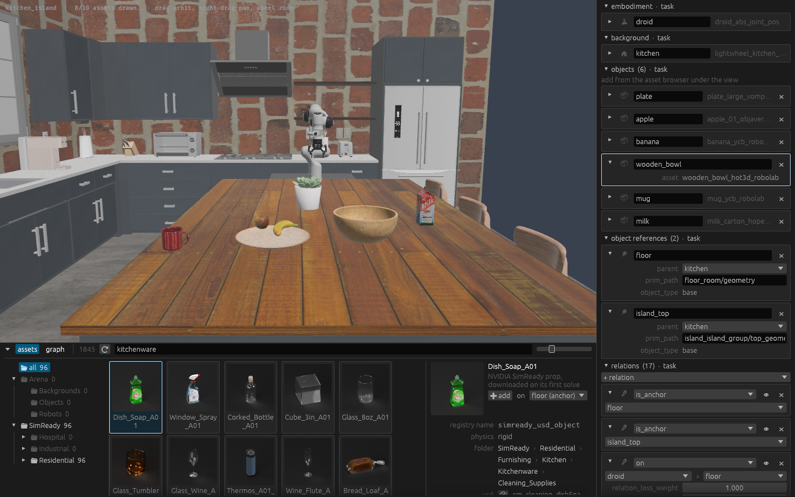
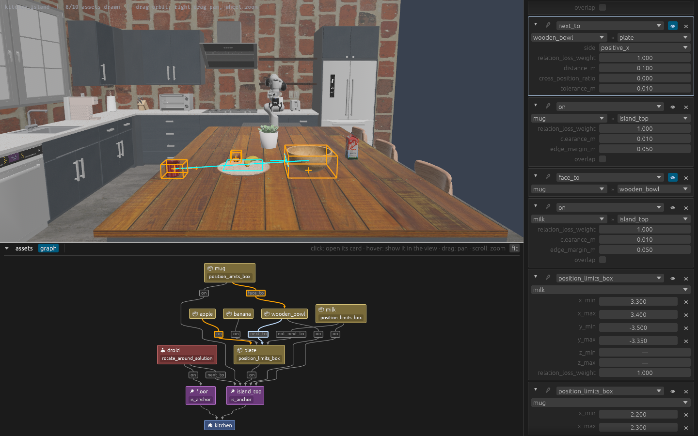

# arena-composer

> [!WARNING]
> Under heavy development. Expect the commands, the visual editor and the MCP tools to change
> between releases, and things to break.

A live editor, headless renderer and MCP server for [IsaacLab-Arena](https://github.com/isaac-sim/IsaacLab-Arena)
environment specs.

<table>
  <tr>
    <td width="50%"><a href="docs/screenshots/assets.png"></a></td>
    <td width="50%"><a href="docs/screenshots/graph.png"></a></td>
  </tr>
  <tr>
    <td>Search Arena's assets and NVIDIA's SimReady props, and drag one onto the layout. Every entry of the spec is a card in the panel.</td>
    <td>The spatial graph: a node per object, an edge per relation. A click opens its card, and the view draws the relation's shape over the layout.</td>
  </tr>
</table>

- `arena-view <spec>.yaml` opens a window on the layout Arena solves for a spec, with a panel that
  edits it. The file is re-solved and redrawn on every change, whoever made it.
- `arena-mcp` is an MCP server whose tools search assets, add and remove objects, and describe and
  render the solved layout.
- `arena-resolve-layout <spec>.yaml` prints the solved layout as JSON or text.

## Install

Into the venv Arena is installed in, from a release's wheel. `isaaclab_arena` is not on PyPI, so
the package goes where Arena already is. Linux x86_64, Python 3.12 or newer.

```bash
gh release download v0.2.0 -R art-e-fact/arena-composer -p '*.whl' -D /tmp/arena-composer
uv pip install --python <Arena's venv>/bin/python /tmp/arena-composer/*.whl
```

Then point the project's agent clients at the MCP server. `init` writes `bin/arena-mcp` and the
configs Claude Code, VS Code and Cursor read, keeping any that already exist:

```bash
<Arena's venv>/bin/arena-composer init <project>
```

## Developing

See [AGENTS.md](AGENTS.md) and [docs/](docs/).

## License

Licensed under either of

- Apache License, Version 2.0 ([LICENSE-APACHE](LICENSE-APACHE))
- MIT license ([LICENSE-MIT](LICENSE-MIT))

at your option.

Unless you explicitly state otherwise, any contribution intentionally submitted for
inclusion in this work by you, as defined in the Apache-2.0 license, shall be dual
licensed as above, without any additional terms or conditions.
