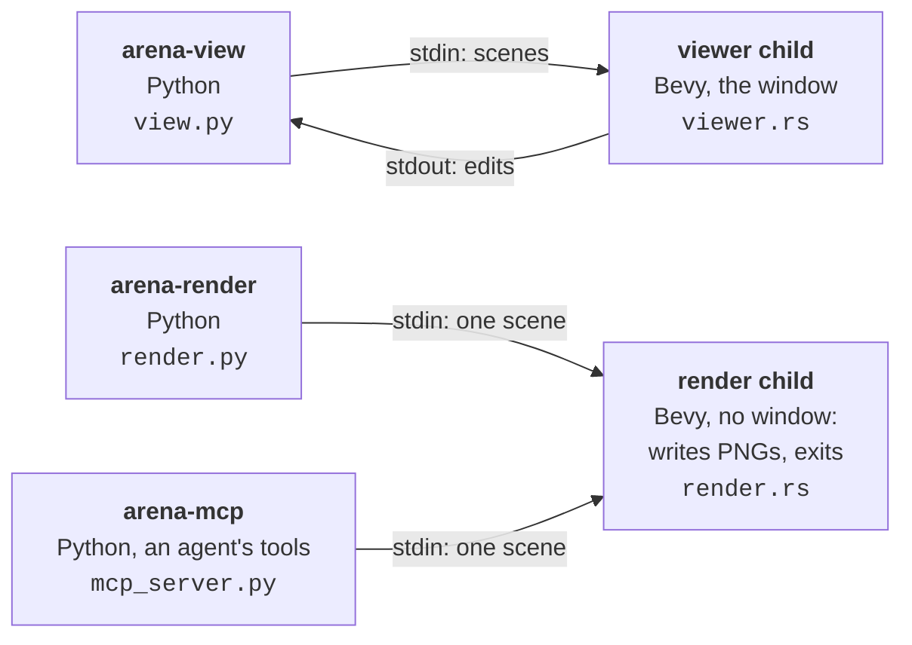
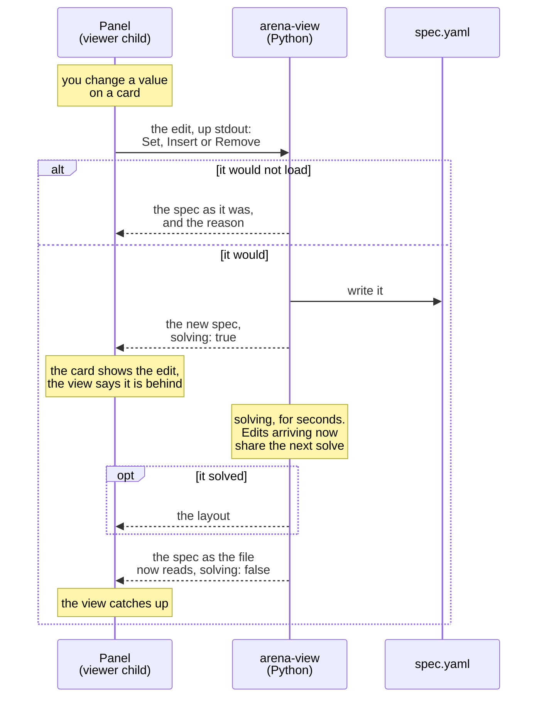

# Architecture

How arena-composer is put together. What it does, and the path from an edit to a picture, are in
the guide's [How it works](../guide/how-it-works.md).

One package, two languages. Python owns everything that needs [OpenUSD](https://openusd.org), the
format Arena's assets are in: Arena's registries, its placement solver, and reading the assets'
geometry and materials. Rust owns [Bevy](https://bevy.org), the game engine that draws them, and
opens no USD. They meet in one [MessagePack](https://msgpack.org) payload. Python places the objects
([resolve_layout.py](../python/arena_composer/resolve_layout.py)), reads their geometry and packs it
([usd/](../python/arena_composer/usd/), [payload.py](../python/arena_composer/payload.py)); Rust
unpacks it ([scene.rs](../src/scene.rs), [spec.rs](../src/spec.rs)) and draws it, in a window to
edit in ([viewer.rs](../src/viewer.rs), [editor/](../src/editor/)) or as PNGs
([render.rs](../src/render.rs)).

The same payload runs through the dev `arena-viewer` straight off disk, in the window or drawn
headless, which is how the Rust side is iterated on without Arena
([development.md](development.md#iterating-on-the-rust-side)).

## The payload

Why MessagePack, how the arrays travel and how the payload splits into a layout half and an editor
half is in the docstring of [payload.py](../python/arena_composer/payload.py). The Rust ends are
[scene.rs](../src/scene.rs) (what is drawn) and [spec.rs](../src/spec.rs) (what the panel edits).
Measured, JSON spent ~760 ms formatting the geometry as decimal text against ~2 ms for `bin` blobs.

- **Arena's frame.** Geometry arrives Z-up, in metres, with every transform baked into the vertex
  positions ([scene.rs](../src/scene.rs), module docs). So the Rust side holds no up-axis, no unit
  scale, no xform-op order and no matrix convention: USD composes row-vector transforms and glam
  column-vector ones, and that is reconciled once, in Python. What baking costs — a repeated mesh
  emitted twice, nothing movable at runtime — is in
  [usd/extract.py](../python/arena_composer/usd/extract.py). How assets are read is
  [usd/AGENTS.md](../python/arena_composer/usd/AGENTS.md).
- **Absent means no news.** Everything around the arrays is an ordinary map: unknown keys are
  ignored, absent ones default. On a message, only `assets` (the layout), `remote`, `indexing`,
  `errors`, `solving` and `problems` may be absent, and each one absent means "keep what you have"
  ([scene.rs](../src/scene.rs) `Scene`). `layouts`, every layout the solve drew with `assets` the
  first, and the `seed` they were drawn from, ride with `assets`. Every message carries the whole
  editor half — spec, file owners and vocabulary — so `editor::Form::take` never pieces one
  together.
- **The JSON dump is a superset.** `arena-resolve-layout --output` writes the resolver's full dump;
  that stays the human- and agent-readable artifact. The payload carries a strict subset of its
  fields.

## Processes

| Process | Where | Why a process of its own |
| --- | --- | --- |
| `arena-view` parent | [view.py](../python/arena_composer/view.py) | asyncio, holds Arena between resolves; one task per concern |
| viewer child | [viewer_process.py](../python/arena_composer/viewer_process.py) → [viewer.rs](../src/viewer.rs) | Bevy's event loop wants the main thread and never gives it back |
| render child | [render_process.py](../python/arena_composer/render_process.py) → [render.rs](../src/render.rs) | one Bevy app per process; exits when the PNGs are written |
| `arena-mcp` | [mcp_server.py](../python/arena_composer/mcp_server.py) | stdio MCP server; see [mcp.md](mcp.md) |

The module docstrings above give the reasoning. The parent polls the spec and the scene its
`external_yaml` includes, re-resolves on change, and sends the result down the child's stdin; the
viewer swaps the layout without dropping the window or moving the camera. A change that will not
build is answered as an edit from the panel that will not solve: the layout stays, and the reason
comes with the spec (`view._reload_on_change`, `payload.encode_spec`;
[errors.md](errors.md#where-a-problem-comes-out)).

### Headless renders

[render.py](../python/arena_composer/render.py) draws a packed scene from named views — `default`
(perspective, framed like the window) and orthographic `top`, `front`, `side` — with no window and
no display server. `arena-render` is its command, and `render_views` its MCP tool; each names the
file every view goes to. [render.rs](../src/render.rs) runs Bevy with `synchronous_pipeline_compilation`,
without which the first frames come back empty.

An asset Bevy cannot load does not stop it drawing: it writes the picture around the gap, so a
failed load looks like a good frame with an object missing. `render.render` therefore treats any
`ERROR` line on the child's stderr as a failed render and raises.

## The pipe

Both directions carry one MessagePack message behind its length in four big-endian bytes, because a
pipe has no message boundaries ([wire.rs](../src/wire.rs), `viewer_process.pack_scene`). The end of
the stream closes the window.

- **Down stdin** — scenes. The editor half is tens of kilobytes against megabytes of geometry, so it
  rides every message rather than being asked for. The vocabulary — assets, and every relation and task kind
  with a control per parameter — is inferred from Arena's registries in
  [catalog.py](../python/arena_composer/catalog.py), never listed by hand. The SimReady props are the
  exception and ride `remote` ([assets.md](assets.md)).
- **Up stdout** — `spec::Request` ([spec.rs](../src/spec.rs)): three edits (`Set`, `Insert`,
  `Remove`) applied through `spec_edit.apply`; `Reindex`, served by `view._serve_assets`; and
  `Regenerate`, a solve from a new seed, answered as an accepted edit is but with nothing written.
  The child's stdout is this channel and nothing else: Bevy logs to stderr.

### Two answers per edit

Writing the YAML takes milliseconds and solving the layout takes seconds, so an edit is answered
twice: the editor half at once with `solving: true`, and the full payload when the solve lands. A
refused edit is answered once, with the unchanged spec, the reason and `solving: false`.

Each step is documented where it happens:

| Step | Where |
| --- | --- |
| answer the edit at once, or refuse it | `view._serve_requests`, `payload.encode_spec` |
| one solver for edits and changes on disk, and one solve per burst of them | `view._solve_when_asked` |
| the edit's own write, kept from the watcher so it is not solved twice | `view._serve_requests` |
| a fresh spec behind every layout, which ends the spinner | `view._draw` |
| take the newest layout and the newest spec-only message separately | `viewer::apply_updates` |
| open the panel from a layout's own spec, once | `viewer::setup` |
| drop a half-made edit only on a new spec or a refusal | `editor::Form::take` |

Do not lower Arena's `ObjectPlacerParams.max_placement_attempts` to make the solve cheaper. Arena
solves `attempts × results` candidates in one batch, so fewer costs the same and ranks a worse
layout first.
