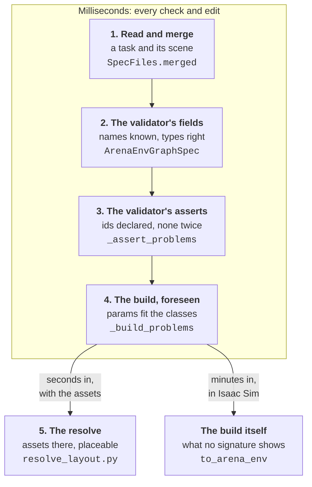

# Errors

A spec an agent or a hand got wrong is the normal case, so a problem with one is data: a `Result`
with one line per problem, each naming the file and the entry to fix, which the agent acts on and
the panel shows. This page is how a wrong spec is found, how an edit on one that is already wrong
is judged, and where the lines come out. The checks are in
[spec_edit.py](../python/arena_composer/spec_edit.py) — start with its module docstring and
`SpecFiles.write` — and what only a resolve can find is in
[resolve_layout.py](../python/arena_composer/resolve_layout.py).

## Where a wrong spec fails

| Gate | When Arena finds it | What fails there |
| --- | --- | --- |
| read and merge | at once | YAML that does not parse; a file that is not a mapping; a key in both files of a pair |
| the validator's fields | at once, all of them | a `registry_name` nothing registers; a wrong type; a missing key; a bare `on` read as `true` |
| the validator's asserts | once the fields they cover are right; the first to fail stops the rest | an id nothing declares; a duplicate id or `cli_override_specs` arg; a composition that does not fit its subtask count |
| the build | minutes in, after Isaac Sim starts | a param the constructor lacks or does not take — `TypeError: object.__init__() takes exactly one argument`, naming no key; an object reference that cannot be built; an `env_cfg_override` field nothing has |
| the resolve | seconds in | a `usd_path` nothing is at, or that is not the single rigid body the sim would spawn; a relation on a light or a ground plane; an object reference the solve places by whose prim has no default-purpose geometry, the only kind Arena bounds |

`spec_edit.check`, and every edit before it writes, run the first four in milliseconds: the first
two as Arena runs them, the fourth computed here, the third both ways. The fifth needs the assets,
so it is `resolve_layout`'s, raised as a `SpecError` carrying the same kind of lines, and
`describe_scene` answers it the same way. What a layout fails is not an error at all: `placement`
reports the checks, and a pass there is necessary for the sim to accept the layout, not sufficient
(`resolve_layout._placement_summary`).

## What is computed here, and why

- **Arena's lines, where Arena gives them.** A field error comes out of pydantic as `path: message`
  (`_message`), with the `Assertion failed, ` prefix dropped and, for a boolean where a string was
  due, a note that YAML 1.1 reads a bare `on`, `off`, `yes` or `no` as one.
- **The asserts are computed off the merged dict.** pydantic runs them only once the fields are
  right, and the first to fail stops the rest, so fixing a field error surfaced the next assert as
  if the fix had introduced it — the deadlock the compare below exists for. `_dangling` finds every
  slot naming an id the spec does not declare, for the compare, where Arena's one line would make
  the second slot read as new; `check` still shows Arena's line for a dangling id, the first.
  `_assert_problems` finds the duplicate ids, the duplicate args and the composition count on any
  spec, at the entry to fix. Arena's own lines stand down by a mark in their text — `_ASSERTS`
  everywhere, `_CROSS_REFERENCE` in the compare. A wording Arena changes falls through and is
  compared as text, which can refuse an edit it should have let through, never the reverse: **the
  compare fails closed.** The checks themselves fail open, below.
- **The build is bound to signatures.** `_build_problems` runs five groups over the merged dict.
  Four take `inspect.signature` of the class Arena will construct — the asset behind a
  `registry_name`, a relation kind, a task kind, an object reference's class by its one joint param
  — and bind the entry's params to it (`_binding`, `catalog.missing_params`,
  `catalog.unexpected_params`). What Arena passes itself counts as given, and given twice is
  refused: a binary relation's reference, an atomic task's `task_description`, a reference's `name`,
  `prim_path`, `parent_asset` and `object_type`; an object's `instance_name` only where the params
  lack it, since Arena fills that by `setdefault`. The rest is what the build asserts without a
  signature: the ids in a list param, which Arena's validator skips and its builder looks up; a
  reference's `prim_path` and its one affordance; and `env_cfg_override` through Arena's own two
  checks.
- **What it cannot see.** A constructor ending in `**kwargs` takes any name, and 304 of 332
  registered assets have one — `LibraryObject` down to `object.__init__` all forward — so
  `unexpected_params` answers `[]` and a misspelt object or background param is still the build's
  to find. A union of the named params over the MRO's `__init__`s would close it. It is left until
  it bites, and the CHANGELOG and `check_spec`'s docstring say what the check covers.
- **Every group fails open.** One that cannot run — Arena moved one of the private names it
  imports — prints `arena-composer: <group> skipped: ...` on stderr and refuses nothing. A composer
  that refused a valid spec would cost more than one that left a problem to the build.
  `_node_lists` fails open on its own, since a rename reaches it outside the groups.
- **Judged off the bytes, not the documents.** `SpecFiles.validate` dumps the edited documents and
  reads the text back with PyYAML, the YAML 1.1 reader Arena uses, before any file is written
  ([mcp.md](mcp.md)). A spec that only validates in memory is not validated.

## An edit on a spec that is already broken

`SpecFiles.write` refuses an edit for what it introduces and nothing else, or an agent with two
problems to fix could fix neither: it compares the problems of the files on disk with those of the
edited text, and whatever was wrong before travels as `remaining_errors`, on the refusal and on the
edit that landed. `_introduced` decides what is the same problem:

- dangling ids slot by slot, since Arena names only the first;
- everything else as lines, with list indices normalised (`_INDEX`) so an entry inserted above does
  not make every line below it read as new, and as a multiset, so a second entry wrong the same way
  as a first is new;
- of two lines that read the same, the one at a path the edit `touched` is the new one — `apply`
  and `add_object` pass the paths they wrote — and failing that, the later of two dangling slots
  and the earlier of two lines.

A pair on disk that does not read at all — a hand edit left a key in both files — has nothing to
compare with, so an edit that makes it read lands, with everything wrong as `remaining_errors`. Two
things are refused by name before any compare, because the compare would blame the other entry: a
rename or an `add_object` onto an id in use. And `_keep_composition_valid` moves `task.composition`
with the subtask count in the same edit, so a task can grow past one subtask at all.

A new check only has to produce lines for the merged dict; the compare treats them as text. Two
things keep it compatible: the line starts with the path to the entry, `objects.2.params.scale`, so
the file prefix, the normalisation and `touched` all find it; and it tolerates any shape a hand edit
leaves — `objects: null`, `relations: 'on'` — since it runs on specs the validator refuses
(`_indexed`, `_entries`).

## How a line reads

`SpecFiles.explain` turns each line into one an agent can act on:

- **The file to fix** comes first where the spec is a pair, spelled as the include spells it:
  `../scenes/scene.yaml: objects.2.registry_name: ...`. `SpecFiles.owner` says which file holds a
  key, and for one neither has — a missing `task`, a first `cli_override_specs` — the file holding
  its kin: the scene's six keys together, the rest with the task. That covers the template's layout
  and the one Arena's gear specs had before 0.3.1, the scene in the entry file and only
  `env_cfg_override` in the include.
- **The closest that exist** follow a name or id nothing declares (`_hint`, `_UNKNOWN`): from the
  registries for an asset, relation or task kind, from the spec's own ids for a slot, narrowed to
  the ids Arena allows there. Up to three within 0.1 of the best are offered, because a shared
  `_ycb_robolab` makes a distant name score well. A name nothing registered is close to says to
  import the module that registers it, since that is the fix.
- **The playbook** in the skill
  ([author-arena-spec/SKILL.md](../python/arena_composer/skills/author-arena-spec/SKILL.md)) maps
  the lines an agent meets to fixes. A new check whose line an agent will meet gets a row.

## Where a problem comes out

| Surface | A wrong spec | A wrong argument, or a crash |
| --- | --- | --- |
| the MCP tools, [mcp_server.py](../python/arena_composer/mcp_server.py) | `{"ok": false, "errors": [...]}`, the `Result` as a dict; `describe_scene` answers a `SpecError` the same way. `render_views` and `get_prim_tree` raise a `ToolError` instead, since each has a result or a reason, never both | a `ToolError` for what the tool saw coming: no file at the path, a scene where the task was asked for (`_spec_path`, `spec_edit.check_entry`), a module that does not import (`_quiet`). The SDK withholds every other exception behind a bare `Error executing tool`, so a crash is a bug; the tests' `_refusal` helper fails on one |
| the panel, [view.py](../python/arena_composer/view.py) | a refused edit is answered once, with the unchanged spec and the reason, and `remaining_errors` go to stderr. A change on disk Arena cannot build leaves the last layout up and sends the reason with the spec as it now reads or, where it no longer reads, as it last did (`payload.encode_spec`). The panel shows each line as a toast ([editor.md](editor.md)) | the loop outlives it: `_files` answers a file that does not read with a `Result`, `_solved` catches whatever Arena raises, and a group that cannot run skips itself |
| the commands | `arena-resolve-layout` raises, and a traceback is the answer in a terminal. `arena-render` prints `<spec>: <reason>` on stderr, `spec_edit.reasons` as the MCP tools give them, draws the other specs and exits 1; a layout that fails placement is drawn, its verdict on stderr. `arena-composer new` and `init` answer a path they cannot use through `parser.error`, as `arena-render` answers a spec that is missing or a scene, before Arena is imported | a module named by `--import` or `ARENA_COMPOSER_IMPORTS` that does not import is one line on stderr and exit 1, from `arena-view`, `arena-resolve-layout` and `arena-render` alike, naming the module and where it was named (`catalog.load_extensions`) |

## Adding a check

1. Put it with its kind: a group in `_build_problems` for what the build would refuse,
   `_assert_problems` for what Arena's validator asserts last. Off the merged dict, tolerant of any
   shape, naming the entry's path.
2. Sweep before and after. From the template's checkout, with this repo on `PYTHONPATH` in Arena's
   venv, run `spec_edit.check` over every YAML with a `task` key under its `environments/` and under
   Arena's `isaaclab_arena/` and `isaaclab_arena_environments/` — 89 specs today — and diff the
   error lists. A new refusal is a bug in a shipped spec, which the pull request says, or a false
   refusal to fix.
3. Plant the mistake in a copy of a spec and read the line, as the agent will.
4. Test it against the real validator, as [test_spec_edit.py](../tests/test_spec_edit.py) does
   throughout: a test that stubs the check tests the uninteresting half. Those files import Arena,
   so CI skips them ([development.md](development.md#tests)).
5. A CHANGELOG line, and a playbook row if an agent will meet the line.
