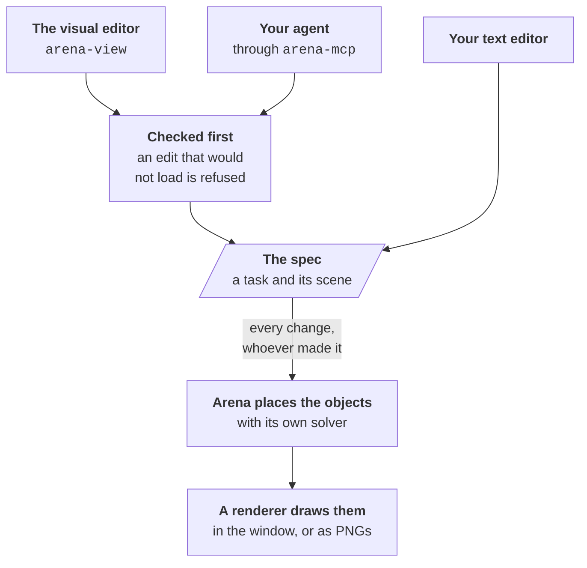
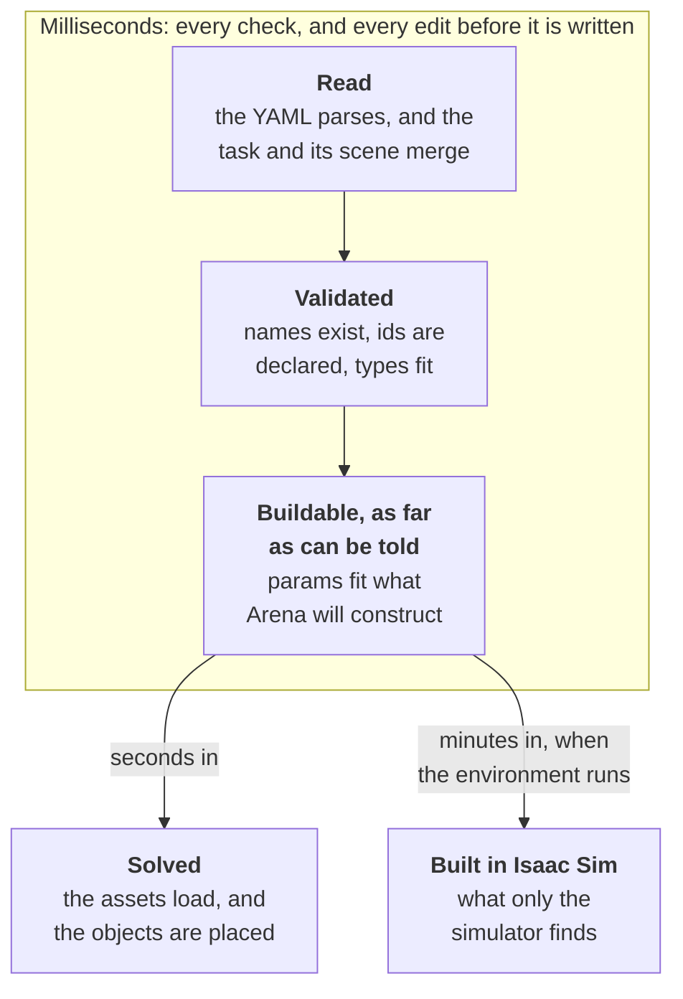

# How it works

arena-composer works on Arena's environment specs: the YAML that names a scene's robot, background
and objects, says how they relate, and gives the robot its task. You say what relates to what,
Arena's solver works out where everything goes, and arena-composer shows you the result in seconds,
without starting Isaac Sim.

This page is the model behind the commands: what a spec holds, how it becomes a layout, and what is
checked along the way. [The visual editor](editor.md) and [Working with an agent](agents.md) put it
to work.

> [!IMPORTANT]
> The ideas here change slowly; the vocabulary does not. Which assets, relation kinds and task kinds
> exist, and what each one takes, comes live from the Arena you have installed: the editor's menus
> list it, and so do your agent's tools.

## One spec, three ways to change it

The YAML is the source of truth. The visual editor, your agent and your text editor all change the
same files, and the view follows whichever one did.



- **Edits are checked.** The editor and the agent's tools write through one place, which refuses an
  edit that would not load, keeps your comments and key order, and takes an object's relations
  along when it is renamed or removed.
- **Arena places things.** The layout comes from Arena's own placement solver, the one that places
  the scene when the environment runs.
- **Isaac Sim never loads.** Python asks Arena for the layout and reads the assets' geometry, and a
  lightweight Rust renderer, [Bevy](https://bevy.org), draws it. It needs no display and no GPU: a
  machine without one draws through Mesa's lavapipe.

## A spec is two files

The task includes the scene through `external_yaml`, and Arena reads the two as one document. Each
key lives in one file or the other:

| File | Holds |
| --- | --- |
| The task, under `environments/tasks/` | `env_name`, `external_yaml` and `task`: what the robot is asked to do |
| The scene, under `environments/scenes/` | `embodiment`, `background`, `objects`, `object_sets`, `object_references` and `relations`: what is there, and where it may go |

Point the commands, the editor and your agent at the task: they send each edit to the file that
holds its key.

`external_yaml` can also list several files, such as the scene and a file of settings several tasks
share. Arena merges them without overrides: a value is set in one file only, except that lists of
entries with an `id`, such as `objects`, join across files, and a file is listed once. An edit
goes to the file holding what it changes, and the editor names, beside each section, the files it
is in.

`arena-composer new environments/tasks/banana_in_bowl.yaml` starts a spec: the task, and a scene of
the same name, holding a pick-and-place that validates, solves and builds. Its scene, without the
empty fields:

```yaml
embodiment:
  id: droid
  registry_name: droid_abs_joint_pos
background:
  id: table
  registry_name: maple_table_robolab
objects:
- id: banana
  registry_name: banana_ycb_robolab
- id: bowl
  registry_name: bowl_ycb_robolab
relations:
- kind: is_anchor
  subject: table
- kind: 'on'
  subject: bowl
  reference: table
- kind: 'on'
  subject: banana
  reference: table
```

A `registry_name` names an asset Arena has registered. An `id` is what the rest of the spec, the
task included, calls it.

## You say how things relate; Arena places them

A spec gives no coordinates. It says how things relate, and the solver finds a layout where every
relation holds:

- **One anchor stays where it is.** `is_anchor` marks what everything else is placed against: the
  background, or a surface of it. It takes no other relation.
- **Every other object gets a relation that places it:** `'on'` a support, `next_to` another object,
  `at_position`, or within `position_limits`. One without gets a warning (below). `align_with`
  lines it up with another object along one axis, beside the relation that places it.
- **Object references name part of an asset**, such as a tabletop or a drawer, so that things can
  stand on it, or the task can open it.
- **An object set is one id for several assets**, standing for whichever member Arena picks.

> [!WARNING]
> Quote the kind `'on'`. Arena reads YAML 1.1, where a bare `on` is the boolean `true`. The editor
> and your agent's tools quote it for you; by hand, you have to.

Assets, relation kinds and task kinds come from Arena's registries, plus about 2,200 of NVIDIA's
SimReady props once they are indexed: from Isaac Sim's bucket, and from SimReady Central on Hugging
Face. Assets and kinds your project registers itself appear once the
module that registers them is imported: `--import MODULE` names it for a command, and
`ARENA_COMPOSER_IMPORTS` for all of them.

## One layout, or many

Arena draws a new layout every time the environment resets, so a spec stands for many layouts.
arena-composer solves several at once, one for each environment Arena would start, and holds them
still with a seed so that two edits can be compared: `--seed N`, or else the spec's
`placer_params.placement_seed`. The visual editor pages through five of them, and draws new ones on
request.

Each layout is checked: everything rests on what it is `'on'`, nothing overlaps, every `next_to`
holds. Passing makes a layout fit for the simulator, not proven in it: whether things settle, and
whether the robot can reach them, only Isaac Sim can tell.

So before you call a spec done, solve several layouts and count the passes:

```bash
arena-resolve-layout environments/tasks/banana_in_bowl.yaml --samples 8 --format text
```

```text
banana_in_bowl  (seed 42, valid layout; 8/8 samples passed, 8 distinct; not run: clutter_on_relation, align_with, next_to, not_next_to, face_to, physics_settled, ik_reachable)
```

Under *not run* are the checks for relation kinds the spec does not use, and the two only the
simulator decides. Your agent runs the same count, and keeps at it until all eight pass. Along with
the count come **warnings**: what passes every check and still cannot work in the sim, such as an
object nothing places, a relation on the anchor, a robot that starts inside the table, or a
background that would fall.

## When a spec is wrong

While you write a spec, a wrong one is the normal case, so a problem is a line to act on, not a
crash. Each line names the file to fix and the entry in it, and a name nothing has registered comes
with the closest ones that exist:

```text
../scenes/banana_in_bowl.yaml: objects.1.registry_name: Unknown asset registry_name 'bowl_ycb'; did you mean 'bowl_ycb_robolab'?
```

Most problems are found in milliseconds, before an edit is even written. A few need the assets, and
some only the simulator finds:



- **An edit that would break the spec is refused,** from the editor and from an agent alike, and the
  files stay as they were.
- **A spec that is already broken can still be fixed,** one edit at a time. An edit is refused only
  for a problem it introduces; the ones that were there before come back as remaining errors.
- **Some problems need the solve,** such as an asset file that is not where the spec says, or a param
  an asset does not take. They show seconds in, not as you type.

| Where you are | What you see |
| --- | --- |
| The visual editor | A ⚠ on the card of each entry that is wrong, which you hover to read. A refused edit, or a change on disk that does not build, is an error in the corner of the view until you close it, and leaves the last layout up. |
| Your agent | `"ok": false` and the errors, which the agent works through. |
| `arena-render` | `<spec>: <reason>` on stderr. It draws the other specs, and exits 1. |
| `arena-resolve-layout` | A traceback. |

## Going deeper

- [The visual editor](editor.md): editing a spec with its layout beside it.
- [Working with an agent](agents.md): handing the writing to an agent, and watching it work.
- [Arena's environment definition](https://isaac-sim.github.io/IsaacLab-Arena/main/pages/concepts/environment/environment_definition.html):
  the spec format, from Arena's side.
- For contributors: [how arena-composer is built](../docs/architecture.md), and
  [how a wrong spec is found](../docs/errors.md).
